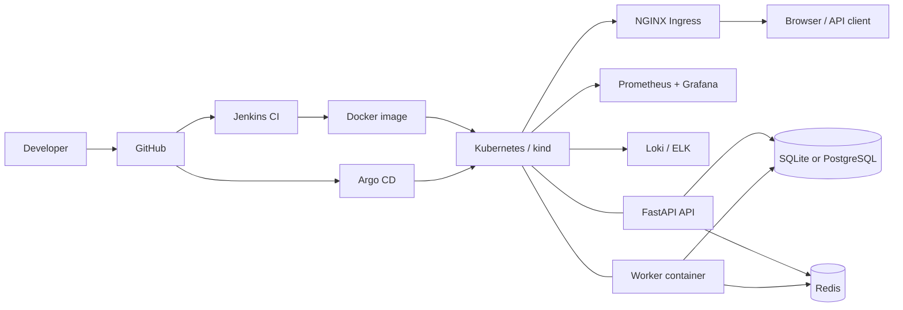

# DevPlane - Self-Hosted Internal Developer Platform

DevPlane is a small but complete Internal Developer Platform (IDP) control plane built for a DevOps capstone. It lets a team register services, provision ephemeral environments, trigger and roll back deployments, manage feature flags and secret references, inspect platform operations, and review an immutable audit trail.

The application is wrapped in the full delivery lifecycle: Git workflow, Jenkins CI, a non-root Docker image, Kubernetes with kind, Helm, Kustomize, blue-green and canary delivery, Ansible, Terraform, Prometheus/Grafana, Loki/ELK logging, and Argo CD GitOps.

## Contents

- [Architecture](#architecture)
- [Feature set](#feature-set)
- [Quick start](#quick-start)
- [Tests and lint](#tests-and-lint)
- [Docker Compose](#docker-compose)
- [Kubernetes with kind](#kubernetes-with-kind)
- [Helm](#helm)
- [CI/CD and GitOps](#cicd-and-gitops)
- [Ansible and Terraform](#ansible-and-terraform)
- [Observability and logging](#observability-and-logging)
- [API surface](#api-surface)
- [Security](#security)
- [Demo flow](#demo-flow)
- [Repository layout](#repository-layout)
- [Validation status](#validation-status)
- [Limitations](#limitations)

## Architecture



Application layers:

```text
HTTP routers -> domain services -> repositories -> SQLAlchemy models
```

- The API and a separate worker share the database. FastAPI `BackgroundTasks` kicks off provisioning immediately; the worker makes progress idempotently and also reaps expired environments.
- SQLite is the zero-friction local default. PostgreSQL is supported through a Compose override or `DATABASE_URL`.
- Redis is wired into health checks and is available for future queue/cache use. The current demo worker polls the database rather than consuming a Redis queue.

## Feature set

- JWT authentication with `admin` and `developer` roles.
- Service catalog with ownership, repository URL validation, and audit events.
- Environment lifecycle: `provisioning -> running -> terminated`, plus failure handling.
- Environment TTL and an automatic reaper in the worker and admin API.
- Deployment records with rolling, blue-green, and canary strategy metadata.
- Deployment rollback and admin-controlled status transitions.
- Feature flags and secret references. Secret references store a provider/path, never the secret value.
- Immutable audit log enforced with SQLAlchemy event listeners.
- Operations registry for pods, logs, deployment status, Terraform plan status, and Jenkins job status. Live integrations are used when configured; otherwise honest stubs are returned.
- Prometheus metrics for HTTP traffic, environments, services, active users, and deployments.
- Browser UI for catalog, environments, deployments, flags/secrets, ops tools, and admin/audit views.

## Quick start

### Prerequisites

- Miniconda (or a Python 3.11 virtual environment)
- Git
- Optional: Docker Desktop, kind, kubectl, Helm for container and cluster demos

### Local API and UI

```powershell
conda create -n capstone_devops python=3.11 -y
conda activate capstone_devops
python -m pip install -r requirements-dev.txt
Copy-Item .env.example .env
# Generate a unique JWT signing key and replace SECRET_KEY in .env
python -c "import secrets; print(secrets.token_urlsafe(48))"
uvicorn app.main:app --reload --host 0.0.0.0 --port 8000
```

Open <http://127.0.0.1:8000>. API documentation is at <http://127.0.0.1:8000/docs>.

`APP_ENV=development` permits the placeholder key for local demos only. Docker, Kubernetes, staging, and production refuse to start with a placeholder or a key shorter than 32 characters.

Seeded demo accounts:

| Role | Email | Password |
| --- | --- | --- |
| admin | admin@devplane.local | admin123 |
| developer | dev@devplane.local | dev123 |

Change these credentials in `.env` before any shared demo. Never commit `.env`.

### Database migrations

```powershell
conda run -n capstone_devops alembic upgrade head
```

Local SQLite startup calls `create_all` for convenience. PostgreSQL deployments rely on Alembic; the Docker entrypoint runs `alembic upgrade head` when `RUN_MIGRATIONS=1`.

## Tests and lint

```powershell
conda run -n capstone_devops pytest
conda run -n capstone_devops pytest --cov=app --cov-report=term-missing
conda run -n capstone_devops ruff check app tests worker
```

Current baseline: 40 tests passing, 93% statement coverage (`pytest --cov=app`). The suite covers authentication and roles, security configuration, catalog, environments and TTL, deployments and rollback, flags, secret references, audit immutability, metrics (including the protected scrape endpoint), health, ops stubs, environment ownership checks, and validation errors.

## Docker Compose

The base stack is API, worker, and Redis:

```powershell
docker compose up --build -d api worker redis
docker compose ps
docker compose logs -f api
```

Open <http://127.0.0.1:8000>. The API container runs Alembic before starting because `RUN_MIGRATIONS=1`.

Compose requires `SECRET_KEY` to be set; if it is missing or empty, `docker compose` stops with a configuration error. A placeholder value passes Compose but the API refuses to start because `APP_ENV=docker`.

Run `scripts/setup-secrets.ps1` (or `./scripts/setup-secrets.sh`) once before the first `docker compose up`. It generates `METRICS_TOKEN`, stores it in `.env` and writes the same value to `monitoring/secrets/metrics_token` for Prometheus. The `/metrics` scrape endpoint is fail-closed: without a token it answers `503`, and with a token it requires `Authorization: Bearer <token>`.

### PostgreSQL

The override keeps the same API/worker but points them at PostgreSQL. The profile flag is required:

```powershell
docker compose --profile postgres -f docker-compose.yml -f docker-compose.postgres.yml up --build -d
```

### Observability profile

```powershell
docker compose --profile observability up -d
```

- Grafana: <http://127.0.0.1:3000> (`admin` / `admin` by default)
- Prometheus: <http://127.0.0.1:9090>
- Loki: <http://127.0.0.1:3100>

### Optional profiles

```powershell
docker compose --profile elk up -d
docker compose --profile security up -d sonarqube
docker compose --profile fluentd up -d fluentd
```

The ELK stack is memory-hungry; give Docker Desktop at least 6 GB of RAM.

## Kubernetes with kind

### Automated path

Windows PowerShell:

```powershell
powershell -ExecutionPolicy Bypass -File scripts/kind-up.ps1
```

Linux/macOS:

```bash
./scripts/kind-up.sh
```

The script creates the `devplane-kind` cluster, installs **pinned** versions of ingress-nginx (`controller-v1.15.1`) and metrics-server (`v0.9.0`), builds and loads `devplane-api:local`, then creates the `devplane` namespace and the `devplane-secrets` Secret **before** applying `kubernetes/overlays/dev`. The Secret contains a generated `SECRET_KEY`, a generated PostgreSQL password, a matching `DATABASE_URL`, a generated `METRICS_TOKEN` and the bootstrap passwords. The API and worker run Alembic automatically and use the in-cluster PostgreSQL instance. The repository does not ship a usable Secret manifest; `kubernetes/base/secret.example.yaml` documents the required keys for manual installs.

### Access

Kind maps ingress port 80 to host port 8081. Either add a hosts entry:

```text
127.0.0.1 devplane.local
```

then open <http://devplane.local:8081>, or send the Host header directly:

```powershell
Invoke-WebRequest -UseBasicParsing -Headers @{Host='devplane.local'} http://127.0.0.1:8081/
```

Port-forward is also available:

```powershell
kubectl -n devplane port-forward svc/devplane-api 8000:80
```

### Runtime checks

```powershell
kubectl -n devplane get pods,pvc,svc,hpa,ingress
kubectl -n devplane rollout status deploy/devplane-api
kubectl -n devplane logs deploy/devplane-api --tail=50
```

### Blue-green and canary

The main `devplane-api` Service selects `version: blue`. `devplane-api-blue` and `devplane-api-green` always target a specific color. Switch the live pointer with:

```powershell
kubectl -n devplane patch svc devplane-api --type merge --patch-file kubernetes/blue-green/select-green.json
```

The canary overlay adds a separate deployment, service, and NGINX canary Ingress at 10% weight:

```powershell
kubectl apply -k kubernetes/overlays/canary
```

See [docs/deployment-strategy.md](docs/deployment-strategy.md) and [docs/kubernetes.md](docs/kubernetes.md).

### Cleanup

```powershell
kind delete cluster --name devplane-kind
```

## Helm

```powershell
$secret = python -c "import secrets; print(secrets.token_urlsafe(48))"
$pg = python -c "import secrets; print(secrets.token_urlsafe(24))"
$admin = python -c "import secrets; print(secrets.token_urlsafe(18))"
$dev = python -c "import secrets; print(secrets.token_urlsafe(18))"
$metrics = python -c "import secrets; print(secrets.token_urlsafe(32))"
helm lint helm/devplane --set-string secret.SECRET_KEY=$secret --set-string secret.POSTGRES_PASSWORD=$pg --set-string secret.BOOTSTRAP_ADMIN_PASSWORD=$admin --set-string secret.BOOTSTRAP_DEV_PASSWORD=$dev --set-string secret.METRICS_TOKEN=$metrics
helm template devplane helm/devplane --set-string secret.SECRET_KEY=$secret --set-string secret.POSTGRES_PASSWORD=$pg --set-string secret.BOOTSTRAP_ADMIN_PASSWORD=$admin --set-string secret.BOOTSTRAP_DEV_PASSWORD=$dev --set-string secret.METRICS_TOKEN=$metrics
helm upgrade --install devplane helm/devplane --namespace devplane --create-namespace --set-string secret.SECRET_KEY=$secret --set-string secret.POSTGRES_PASSWORD=$pg --set-string secret.BOOTSTRAP_ADMIN_PASSWORD=$admin --set-string secret.BOOTSTRAP_DEV_PASSWORD=$dev --set-string secret.METRICS_TOKEN=$metrics
```

The chart includes API and worker deployments, a PostgreSQL Deployment and PVC, Redis, Services, Ingress, HPA, RBAC, ConfigMap, Secret, and NOTES. All five secret values (`SECRET_KEY`, `POSTGRES_PASSWORD`, `BOOTSTRAP_ADMIN_PASSWORD`, `BOOTSTRAP_DEV_PASSWORD`, `METRICS_TOKEN`) are required and have no usable defaults. Override `image.repository`, `image.tag`, `ingress.host`, and resources in a values file for a real environment; use `externalDatabase.url` with `postgresql.enabled=false` to use a managed database.

## CI/CD and GitOps

- `Jenkinsfile` runs checkout, Python environment setup, lint, tests with coverage/JUnit, optional SonarQube, Docker build with cache, a blocking Trivy scan (`TRIVY_EXIT_CODE=1` by default), optional registry push, and optional Kubernetes deploy.
- Jenkins parameters: `IMAGE_REGISTRY`, `DEPLOY_TO_K8S`, `K8S_OVERLAY`.
- `gitops/argocd/application.yaml` points Argo CD at this repository (`https://github.com/pyrosensei/Capstone_Devops.git`, public, so Argo CD clones it anonymously) and at `kubernetes/overlays/dev`.
- Argo CD is installed by `scripts/argocd-up.ps1` / `scripts/argocd-up.sh` (pinned to Argo CD `v3.5.6`) and the Application is applied from `gitops/argocd/application.yaml`. The sync was verified live: the Application reports `Synced` / `Healthy` and Argo CD owns the API, worker, PostgreSQL, Redis, HPA, PDB, Ingress and RBAC objects in the `devplane` namespace. Evidence: [docs/evidence/argocd-sync.md](docs/evidence/argocd-sync.md) and `docs/screenshots/argocd-applications.png`.
- The `devplane-secrets` Secret stays outside Argo CD: it is created by `scripts/kind-up.*` (or Terraform/Ansible) and is never pruned by a sync.

Setup notes: [docs/jenkins-setup.md](docs/jenkins-setup.md), [docs/branch-strategy.md](docs/branch-strategy.md).

## Ansible and Terraform

Ansible:

```bash
cd ansible
ansible-playbook playbooks/install-tools.yml
ansible-playbook playbooks/site.yml
ansible-playbook playbooks/k8s-deploy.yml
```

The Ansible roles target Debian/Ubuntu-style hosts. Use WSL or a Linux VM on Windows. `site.yml` installs Docker and deploys the Compose stack; `k8s-deploy.yml` applies the Kubernetes overlay.

Terraform:

```bash
cd terraform
cp terraform.tfvars.example terraform.tfvars
terraform init
terraform plan
terraform apply
```

Set `enable_kind = true` and `is_windows = true` where applicable. The root module provisions a local kind cluster, builds/loads the image, optionally installs ingress-nginx, renders application config, and can apply the manifests. Cloud provider files under `terraform/cloud-stubs/` are templates, not deployed infrastructure.

Details: [docs/terraform-ansible.md](docs/terraform-ansible.md).

## Observability and logging

- Application metrics: `GET /metrics` (`devplane_*` series).
- Prometheus config: `monitoring/prometheus.yml`; alert rules: `monitoring/alert-rules.yml`.
- Grafana datasources and the DevPlane dashboard are provisioned automatically.
- Loki and Promtail collect container logs in the `observability` profile.
- The optional ELK profile provides Elasticsearch, Logstash, and Kibana through `logging/elk/logstash.conf`.
- Optional Fluentd profile uses `logging/fluentd/fluent.conf`.

Details: [docs/observability.md](docs/observability.md).

## API surface

All `/api/v1` routes except registration/login require a Bearer JWT.

| Area | Routes |
| --- | --- |
| Auth | `POST /api/v1/auth/register`, `POST /api/v1/auth/login`, `GET /api/v1/auth/me` |
| Catalog | `GET/POST /api/v1/services`, `GET/PATCH/DELETE /api/v1/services/{id}` |
| Environments | `GET/POST /api/v1/services/{id}/environments`, `PATCH /api/v1/services/environments/{env_id}`, `POST /api/v1/services/environments/{env_id}/terminate` |
| Deployments | `GET/POST /api/v1/environments/{env_id}/deployments`, `GET /api/v1/deployments/{id}`, `POST /api/v1/deployments/{id}/rollback`, `PATCH /api/v1/deployments/{id}/status` |
| Flags | `GET/POST /api/v1/services/{id}/flags`, `PATCH/DELETE /api/v1/services/{id}/flags/{flag_id}` |
| Secret refs | `GET/POST /api/v1/services/{id}/secrets`, `DELETE /api/v1/services/{id}/secrets/{secret_id}` |
| Ops registry | `GET /api/v1/ops/tools`, `/pods`, `/logs`, `/deployment-status`, `/terraform-plan-status`, `/jenkins-job-status` |
| Admin | `GET /api/v1/admin/metrics`, `GET /api/v1/admin/audit`, `GET /api/v1/admin/deployments`, `POST /api/v1/admin/maintenance/expire-environments` |
| Platform | `GET /health`, `GET /health/live`, `GET /health/ready`, `GET /metrics`, `GET /` (UI) |

Role rules: developers can manage catalog entries, environments, deployments, flags, and secret references. Admin-only operations are service deletion, deployment status override, audit access, platform metrics, and the manual TTL reaper.

Public registration always creates a `developer`. The request schema rejects a `role` field, so self-service signup cannot grant admin access. Admin users come only from bootstrap seeding or an explicit administrative process.

## Security

- Container and pod run as UID/GID `10001`, non-root, with a read-only root filesystem, dropped Linux capabilities, and `RuntimeDefault` seccomp.
- Kubernetes Secrets are referenced through environment variables; `.env` is ignored by Git.
- Self-registration always creates a developer account; the API does not accept a role during signup.
- Outside development, startup fails if `SECRET_KEY` is empty, a known placeholder, or shorter than 32 characters.
- Ops registry queries are restricted to `OPS_ALLOWED_NAMESPACES` (default `default,devplane`) instead of trusting arbitrary user-supplied namespaces.
- The API's secret-reference feature stores only provider and path metadata.
- RBAC limits the in-cluster Kubernetes client to pods, logs, and deployments.
- Optional NetworkPolicy is provided in `kubernetes/security/networkpolicy.yaml`.
- JWT signing and bootstrap credentials must be changed for any shared demo. The password guard is enforced **outside demo mode**: `DEMO_MODE=true` (used by the local demo, the dev overlay and the Helm dev values) explicitly allows the well-known `admin123` / `dev123` credentials, while every other environment refuses them.
- Blocking image scanning with Trivy in Jenkins (HIGH/CRITICAL) and optional SonarQube.

Details: [docs/security.md](docs/security.md).

## Demo flow

1. Start the local stack or the kind cluster.
2. Open the UI and log in as `admin@devplane.local`.
3. Create a service with a repository URL and tech stack.
4. Create an ephemeral environment with a TTL.
5. Deploy `v1.0.0`, then deploy `v2.0.0` and roll back.
6. Toggle a feature flag and add a secret reference.
7. Open the ops registry and run `get_pods`; with a cluster it reports `source: kubernetes`.
8. Review admin metrics and the immutable audit trail.
9. Run the automated smoke test:

```powershell
# Local or Compose
conda run -n capstone_devops python scripts/smoke.py

# Kubernetes through a port-forward
conda run -n capstone_devops python scripts/smoke.py --base-url http://127.0.0.1:8000
```

On PowerShell, `scripts/demo.ps1` wraps the smoke test and honours `DEVPLANE_URL`.

A fuller viva script is in [docs/demo.md](docs/demo.md).

## Repository layout

```text
app/                 FastAPI routers, services, repositories, models, schemas, UI
worker/              Polling worker entry point
tests/               Pytest suite and fixtures
alembic/             Database migrations
kubernetes/          Kustomize base, dev/canary overlays, security policy
helm/devplane/       Helm chart
terraform/           Local kind provisioner and app config modules
ansible/             Docker/k8s tooling roles and deploy playbooks
monitoring/          Prometheus config, alerts, Grafana provisioning/dashboard
logging/             Loki, Promtail, Fluentd, ELK configuration
gitops/              Argo CD Application
scripts/             kind bootstrap, smoke test, demo, notification stub
docs/                Phase documentation, deployment/security notes, screenshots
```

## Validation status

Validated on Windows with Docker Desktop and kind:

- `pytest`: 40 passed; 93% statement coverage (`pytest --cov=app`).
- `ruff check app tests worker`: passed.
- `docker build`: multi-stage image built successfully.
- Docker Compose API + worker + Redis: healthy; smoke test passed.
- kind cluster: API 2/2, worker 1/1, Postgres 1/1, Redis 1/1, Postgres PVC bound, HPA active.
- Ingress through `http://127.0.0.1:8081` with `Host: devplane.local`: HTTP 200.
- Cluster smoke test: passed, including `source: kubernetes` for the ops registry.
- `kubectl kustomize` for dev and canary overlays: passed.
- `docker compose config` and the PostgreSQL override: passed.
- PostgreSQL runtime: API, worker, and Postgres healthy; smoke test passed against Postgres.
- Observability: Prometheus targets UP, Grafana datasources/dashboard provisioned, Loki receiving API logs.
- `helm lint` and `helm template`: passed.
- Terraform 1.16.6: `fmt -check`, `validate`, and `plan` passed.
- Ansible core 2.21: all three playbooks pass `--syntax-check` (run from WSL).
- Argo CD v3.5.6 installed in the kind cluster: the `devplane` Application is `Synced` / `Healthy` against this repository.
- Protected scrape endpoint: Prometheus targets report `up` while `/metrics` returns `401` without the bearer token.
- Screenshots of the UI, Grafana dashboard, Prometheus targets and the Argo CD Application are in `docs/screenshots/` (see `docs/screenshots/README.md`).

Jenkins, SonarQube, Trivy, and the cloud integrations still need their own servers or accounts. A local Jenkins controller was set up and the pipeline job configured, but a full green pipeline run and the SonarQube scan are still pending (see `docs/evidence/jenkins-local.md`).

## Limitations

- Provisioning and deployment are simulated. The worker flips statuses and writes log snippets; no real workload is deployed by the control plane.
- Terraform and Jenkins ops tools are read-only summaries. Jenkins requires credentials and Terraform requires a generated `tfplan.json` for live values.
- The Kubernetes demo uses a single PostgreSQL Deployment with a ReadWriteOnce PVC. SQLite remains the zero-friction local default and is not intended for multi-replica deployments. Use a managed or highly available PostgreSQL service in production.
- The worker polls the database. A production design would use a durable queue such as Celery/RQ/Arq plus Redis.
- Argo CD is installed by a separate script (`scripts/argocd-up.*`); the cloud Terraform files are templates, not part of the one-command local stack.
- Authentication is local JWT, not OIDC/SSO.

## Further documentation

- [TECHNICAL_REPORT.md](TECHNICAL_REPORT.md) - objectives, design, results, challenges, future scope
- [docs/kubernetes.md](docs/kubernetes.md) - cluster, probes, blue-green/canary, troubleshooting
- [docs/deployment-strategy.md](docs/deployment-strategy.md) - delivery strategies
- [docs/jenkins-setup.md](docs/jenkins-setup.md) - CI setup and parameters
- [docs/evidence/](docs/evidence/) - captured command output backing the validation claims
- [docs/screenshots/README.md](docs/screenshots/README.md) - captured screenshots and how to re-create them
- [docs/observability.md](docs/observability.md) - metrics, dashboards, logs, alerts
- [docs/terraform-ansible.md](docs/terraform-ansible.md) - infrastructure automation
- [docs/security.md](docs/security.md) - controls and hardening
- [docs/demo.md](docs/demo.md) - viva/demo script
- [docs/branch-strategy.md](docs/branch-strategy.md) - Git workflow
