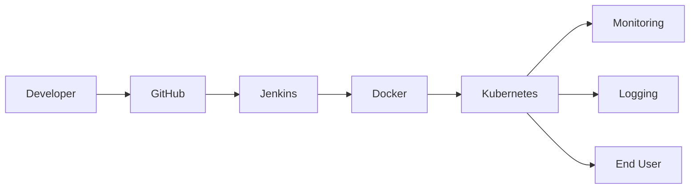

# DevPlane — Self-Hosted Internal Developer Platform

Control plane for an internal developer platform: service catalog, environments, deployments, ops registry, audit log, feature flags, and Prometheus metrics. Built as a complete DevOps capstone (Git → Jenkins → Docker → Kubernetes → Ansible → Terraform → monitoring → logging → security → GitOps).

## Architecture



See [TECHNICAL_REPORT.md](TECHNICAL_REPORT.md) for objectives, tools, results, and future scope.

## Constraints implemented

- Backend: FastAPI on Python 3.11 (no Flask/Django)
- Miniconda env: `capstone_devops`
- Database: **SQLite by default** (local demos); PostgreSQL via Compose profile `postgres` or `DATABASE_URL`
- SQLAlchemy 2.0 + Alembic
- Redis for health/cache wiring; background provisioning via FastAPI `BackgroundTasks` + worker container
- Clean layers: routers → services → repositories → models
- Generic UI: Jinja2 + static JS

## Miniconda setup (exact commands)

```powershell
conda create -n capstone_devops python=3.11 -y
conda activate capstone_devops
python -m pip install -r requirements-dev.txt
copy .env.example .env
uvicorn app.main:app --reload --host 0.0.0.0 --port 8000
```

Open http://127.0.0.1:8000 — seeded users:

| Role | Email | Password |
| --- | --- | --- |
| admin | admin@devplane.local | admin123 |
| developer | dev@devplane.local | dev123 |

API docs: http://127.0.0.1:8000/docs

### Tests

```powershell
conda activate capstone_devops
pytest --cov=app --cov-report=term-missing
```

### Makefile (from repo root)

`make install`, `make run`, `make test`, `make docker-up`

## Docker Compose

```powershell
docker compose up --build -d api worker redis
```

Observability profile (Prometheus, Grafana, Loki, Fluentd):

```powershell
docker compose --profile observability up -d
```

PostgreSQL (optional; point `DATABASE_URL` at it):

```powershell
docker compose --profile postgres up -d postgres
```

## Syllabus phases in this repo

| Phase | Path |
| --- | --- |
| 1 Git | `.gitignore`, this README, [docs/branch-strategy.md](docs/branch-strategy.md) |
| 2 Jenkins | [Jenkinsfile](Jenkinsfile), [docs/jenkins-setup.md](docs/jenkins-setup.md) |
| 3 Docker | [Dockerfile](Dockerfile), [docker-compose.yml](docker-compose.yml) |
| 4 Kubernetes | [kubernetes/](kubernetes/), [scripts/kind-up.ps1](scripts/kind-up.ps1) |
| 5 Ansible | [ansible/](ansible/) |
| 6 Terraform | [terraform/](terraform/) |
| 7 Monitoring | [monitoring/](monitoring/) — scrape `/metrics` |
| 8 Logging | [logging/](logging/) |
| 9 Security | [docs/security.md](docs/security.md), non-root image, K8s Secrets |
| 10 Deploy strategy | [docs/deployment-strategy.md](docs/deployment-strategy.md) |
| 11 GitOps | [gitops/argocd/](gitops/argocd/) |

Bonus: Helm chart, Ingress, HPA, Slack stub (`scripts/notify_stub.py`), coverage reports, api+worker multi-container, cloud Terraform stubs.

## API surface (auth: Bearer JWT)

- `POST /api/v1/auth/register` `POST /api/v1/auth/login` `GET /api/v1/auth/me`
- Catalog: `/api/v1/services`
- Environments: `/api/v1/services/{id}/environments` (async provisioning)
- Deployments: `/api/v1/environments/{id}/deployments`
- Ops registry: `/api/v1/ops/{pods,logs,deployment-status,terraform-plan-status,jenkins-job-status}`
- Flags/secrets: `/api/v1/services/{id}/flags` `/secrets`
- Admin: `/api/v1/admin/metrics` `/audit`
- `GET /health` `GET /metrics`

Kubernetes Python client is used when kubeconfig / in-cluster config exists; otherwise the ops registry returns honest stubs.

## Credentials you must supply for live integrations

The local SQLite demo needs **no cloud account**. Provide these only when you want live (non-stub) behavior:

- Jenkins API user + token (`JENKINS_USER`, `JENKINS_TOKEN`)
- Optional Slack webhook (`SLACK_WEBHOOK_URL`)
- Optional SonarQube URL + token
- Optional cloud keys for AWS/Azure/GCP Terraform stubs
- kind or Minikube installed for the Kubernetes demo (`scripts/kind-up.ps1`)

## Commit history notes

This repository is structured for a viva-ready history, for example:

1. `chore: scaffold FastAPI project and conda docs`
2. `feat: catalog, environments, deployments, auth, audit`
3. `feat: docker compose and non-root image`
4. `feat: jenkins pipeline and tests`
5. `feat: kubernetes manifests, helm, gitops`
6. `feat: ansible, terraform, monitoring, logging`

Use feature branches per [docs/branch-strategy.md](docs/branch-strategy.md).
