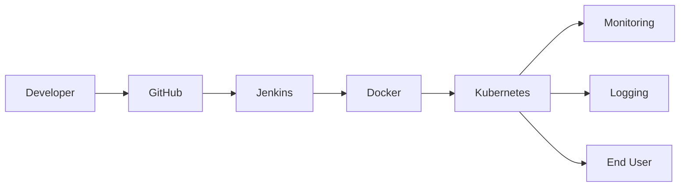

# Technical Report — DevPlane IDP Control Plane

## 1. Problem statement

Engineering teams need a single internal control plane to register services, provision environments, trigger deployments, inspect cluster/ops status, and retain an audit trail — without depending on a commercial PaaS. Students must also demonstrate the full DevOps toolchain around that application.

## 2. Objectives

- Deliver a FastAPI control plane covering catalog, environments, deployments, ops registry, audit, flags, and admin metrics.
- Package the system with Docker, Kubernetes, Jenkins CI, Ansible, Terraform, Prometheus/Grafana, and centralized logging.
- Keep secrets out of Git and run containers as non-root.
- Provide a demo path that works on a laptop (SQLite + Compose) and a cluster path (kind + GitOps).

## 3. Architecture

Internal app layers: HTTP routers → domain services → repositories/SQLAlchemy models. Background workers flip `provisioning` environments and `running` deployments to terminal states.

## 4. Tools used

Python 3.11, FastAPI, Pydantic v2, SQLAlchemy 2, Alembic, SQLite/PostgreSQL, Redis, Docker, Compose, Jenkins, Kubernetes/kind, Helm, Ansible, Terraform, Prometheus, Grafana, Fluentd/Loki, Argo CD, pytest.

## 5. Results

- Working REST API and browser UI at `/`.
- `/metrics` exposes `devplane_*` series for Grafana.
- Jenkinsfile runs install → tests → image build.
- Manifests include Deployment, Service, ConfigMap, Secret, PVC, Ingress, HPA, RBAC.
- Blue-green selectors and canary Ingress annotations documented and versioned in Git.

## 6. Screenshots

Place captures under `docs/screenshots/` (see placeholders). Attach Jenkins, Grafana, `kubectl get pods`, and UI shots to the bound report.

## 7. Challenges

- Windows hosts need `kind`/`kubectl` on PATH; Jenkins `sh` steps prefer a Linux agent.
- In-cluster Kubernetes client requires a ServiceAccount; unit tests use stubs.
- SQLite + multiple containers share a volume; Postgres profile is preferred for multi-replica API.

## 8. Future scope

- Replace JWT with OIDC (Keycloak).
- Real Terraform Cloud / AWS modules once accounts exist.
- Progressive delivery with Argo Rollouts.
- Policy-as-code (OPA/Gatekeeper) and image signing (Cosign).
