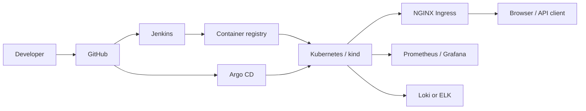
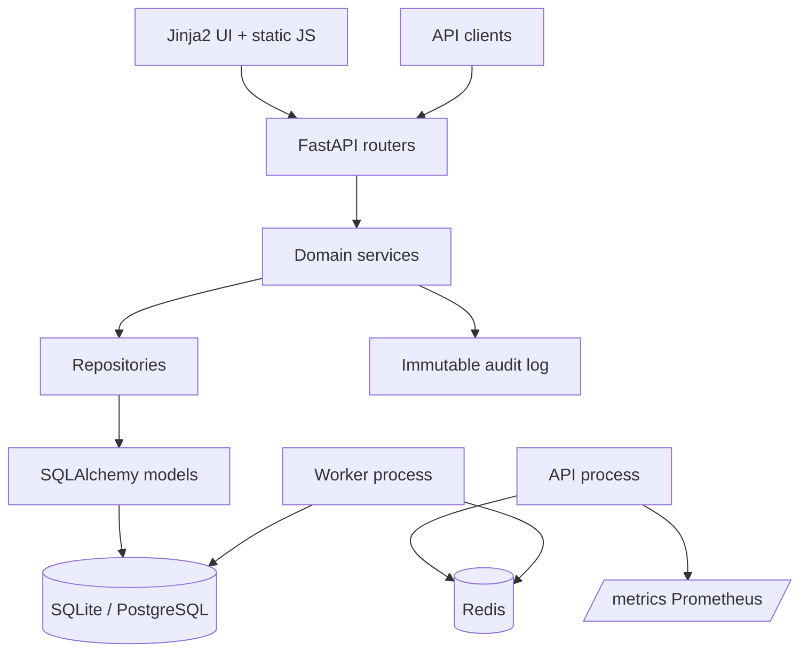

# Tec hnical Report - DevPlane Internal Developer Platform

## 1. Abstract

DevPlane is a self-hosted Internal Developer Platform control plane that gives engineering teams one place to register services, request environments, deploy and roll back releases, manage feature flags and secret references, inspect operational state, and review an immutable audit trail. The application is a FastAPI service on Python 3.11. Around it, the project implements the complete DevOps lifecycle required by the capstone: Git workflow, Jenkins CI, Docker packaging, Kubernetes delivery, Helm and Kustomize, blue-green and canary strategies, Ansible, Terraform, Prometheus/Grafana, centralized logging, security scanning, and Argo CD GitOps.

The repository is designed to be demonstrable on a laptop. SQLite is the default database, Compose runs the API/worker/Redis stack, and a semi-automated kind script produces a working Kubernetes deployment with Ingress and HPA. Optional profiles add PostgreSQL, observability, ELK, Fluentd, and SonarQube.

## 2. Problem statement

Internal teams often depend on a commercial Platform-as-a-Service or on ad-hoc scripts to create services, environments, and deployments. That creates inconsistent workflows, weak auditability, and little visibility for platform operators. A capstone also has to demonstrate the toolchain around the application, not only the application itself.

DevPlane addresses both needs:

- A consistent API and UI for the service lifecycle.
- A durable record of who changed what.
- Operational visibility through metrics, logs, and audit data.
- A reproducible path from source to container to cluster.
- An honest boundary between real integrations and demo stubs.

## 3. Objectives

1. Build a layered FastAPI control plane for catalog, environments, deployments, flags, secrets, ops, audit, and admin metrics.
2. Keep local startup simple: Python 3.11, Miniconda env `capstone_devops`, SQLite, no cloud account required.
3. Provide container and Kubernetes paths with non-root execution and health probes.
4. Implement CI, infrastructure automation, monitoring, logging, security, delivery strategies, and GitOps as versioned artifacts.
5. Verify the result with automated tests and end-to-end smoke tests against Compose and kind.
6. Document limitations so the demo does not overstate what is simulated.

## 4. Architecture

### 4.1 System context



### 4.2 Application components



### 4.3 Layers

- **Routers** validate HTTP input, enforce authentication/roles, and translate domain errors into HTTP responses.
- **Services** own business rules: uniqueness, lifecycle transitions, TTL, rollback, audit events, and feature-flag/secret-reference behavior.
- **Repositories** encapsulate SQLAlchemy queries.
- **Models** define users, services, environments, deployments, feature flags, secret references, and audit rows.
- **Worker** polls pending environments/deployments, performs idempotent transitions, and reaps expired environments.
- **UI** is server-rendered Jinja2 plus vanilla JavaScript; it calls the same authenticated REST API.

### 4.4 Data model

| Entity | Purpose | Key relationships |
| --- | --- | --- |
| `User` | Local account and role | Owns catalog services |
| `CatalogService` | Registered service | Has environments, flags, secret refs |
| `Environment` | Dev/staging/prod/ephemeral instance | Belongs to service; has deployments, TTL |
| `Deployment` | Versioned release attempt | Belongs to environment; strategy, status, logs, rollback link |
| `FeatureFlag` | Per-service toggle | Optional environment scope |
| `SecretReference` | Provider/path pointer | Optional environment scope; never stores the value |
| `AuditLog` | Immutable event trail | Actor, action, entity, detail, timestamp, sequence |

The audit table is protected by SQLAlchemy `before_update` and `before_delete` listeners, so application code cannot rewrite history through the ORM.

## 5. Implementation highlights

### 5.1 Authentication and authorization

- Local registration and login with password hashing.
- JWT bearer tokens signed with `SECRET_KEY`.
- `admin` and `developer` roles enforced through dependencies.
- Public registration always creates a developer; the signup schema rejects a `role` field to prevent privilege escalation.
- Outside development, startup refuses an empty, placeholder, or short `SECRET_KEY`.
- Bootstrap seeding creates one admin and one developer for local demos.
- Internal `.local` email addresses are accepted through a custom Pydantic email type.

### 5.2 Environment lifecycle

1. Create an environment from a catalog service.
2. Status starts at `provisioning`.
3. A FastAPI background task and the polling worker both attempt the same idempotent transition to `running`.
4. An optional TTL sets `expires_at`.
5. The worker and the admin maintenance endpoint terminate expired environments.
6. Terminated environments reject new deployments.

The duplicate `(service, environment name)` case returns `409`, which keeps the lifecycle deterministic.

### 5.3 Deployments and rollback

- A deployment records version, strategy (`rolling`, `blue-green`, `canary`), status, and a log snippet.
- FastAPI background tasks and the worker advance `running` deployments to `succeeded`.
- Rollback creates a new deployment pointing at the previous successful version and records `is_rollback`.
- Admins can correct a status through `PATCH /api/v1/deployments/{id}/status`.
- The Kubernetes manifests track delivery strategy through labels, Services, and Ingress annotations, while the control plane records which strategy was requested.

### 5.4 Feature flags and secret references

- Flags are scoped to a service and optionally to an environment.
- Secret references support `kubernetes`, `vault`, `aws-secrets-manager`, and `azure-key-vault` provider labels plus a path.
- Only the reference is stored. Secret values remain in the external secret store.
- All mutations produce audit events.

### 5.5 Ops registry

`GET /api/v1/ops/tools` advertises the supported operations. Each tool uses a real integration when available:

- **Kubernetes**: in-cluster ServiceAccount or kubeconfig, used for pod listing, pod logs, and deployment status.
- **Terraform**: reads `terraform/tfplan.json` if it exists.
- **Jenkins**: queries the last build when `JENKINS_USER` and `JENKINS_TOKEN` are set.

If an integration is unavailable, the response is clearly labelled `stub` (or `error`) rather than pretending to be live. The test suite forces a nonexistent kubeconfig so results do not depend on the developer machine.

### 5.6 Observability

- Request middleware assigns `X-Request-ID`, measures latency, and records metrics using templated route paths to avoid high-cardinality labels.
- `/metrics` exposes `devplane_*` series.
- Business gauges are recomputed from the database on refresh and startup, so restarts and retries cannot drift values.
- `/health/live` is a process liveness check; `/health/ready` checks the database; `/health` also reports Redis status.
- JSON structured logs include the request ID.

### 5.7 Container and cluster behavior

- Multi-stage Docker build: build dependencies stay out of the runtime image.
- Runtime user `10001`, no login shell, read-only root filesystem in Kubernetes, `/tmp` emptyDir, dropped capabilities, seccomp `RuntimeDefault`.
- Entrypoint runs `alembic upgrade head` only when `RUN_MIGRATIONS=1`.
- Kubernetes startup/readiness/liveness probes use the platform endpoints.
- PodDisruptionBudget protects API availability during voluntary disruption.
- HPA targets CPU and is backed by metrics-server in kind.
- The worker has no HTTP probe and disables the inherited container healthcheck in Compose.

## 6. DevOps phases

| Phase | Implementation | Main artifacts |
| --- | --- | --- |
| 1. Git | Branch/commit conventions, ignores, attributes, line-ending policy | `.gitignore`, `.gitattributes`, `docs/branch-strategy.md` |
| 2. Jenkins | Declarative pipeline with lint, tests, coverage, optional Sonar/Trivy, build, push, deploy | `Jenkinsfile`, `sonar-project.properties`, `docs/jenkins-setup.md` |
| 3. Docker | Multi-stage non-root image, entrypoint migration switch, Compose profiles | `Dockerfile`, `docker-compose.yml`, `docker-compose.postgres.yml` |
| 4. Kubernetes | Kustomize base, dev/canary overlays, probes, PDB, HPA, Ingress, RBAC, PVC | `kubernetes/`, `scripts/kind-up.*` |
| 5. Ansible | Docker and k8s tooling roles, Compose deploy, k8s deploy | `ansible/` |
| 6. Terraform | Local kind module, image build/load, optional ingress, app config rendering | `terraform/` |
| 7. Monitoring | Prometheus scrape config, alert rules, Grafana provisioning/dashboard | `monitoring/` |
| 8. Logging | Loki + Promtail, ELK, optional Fluentd | `logging/` |
| 9. Security | Non-root/read-only pods, RBAC, secret references, NetworkPolicy, scans | `docs/security.md`, `kubernetes/security/` |
| 10. Delivery strategies | Rolling, blue-green Services, canary Ingress | `docs/deployment-strategy.md`, `kubernetes/overlays/canary/` |
| 11. GitOps | Argo CD Application for the dev overlay | `gitops/argocd/application.yaml` |

## 7. Validation and results

### 7.1 Automated tests

Command:

```powershell
conda run -n capstone_devops python -m pytest --cov=app --cov-report=term-missing
```

Result:

- 40 tests passed.
- 93% statement coverage measured with `pytest --cov=app`.
- Covered: auth and roles, inactive-user rejection, self-registration privilege escalation, secret-key/JWT configuration, demo-mode gating, catalog, environment lifecycle and TTL, environments ownership and status authorization, duplicate handling, deployments and rollback, simulated execution reporting, flags, secret references, audit immutability, admin metrics, uptime/readiness, the bearer-token-protected `/metrics` endpoint, validation, and honest ops stubs.

Lint:

```powershell
conda run -n capstone_devops ruff check app tests worker
```

Result: all checks passed.

### 7.2 Docker

- Multi-stage image built successfully.
- Compose API became healthy; Redis healthy; worker running.
- `scripts/smoke.py` passed against Compose: service creation, environment provisioning, two deployments, rollback, feature flag, ops tools, admin metrics, and metrics scrape.
- A worker healthcheck inherited from the image was disabled in Compose because the worker does not serve HTTP.
- The PostgreSQL override was also run end-to-end: Postgres, API, and worker became healthy, the smoke test passed, and rows were confirmed in Postgres.
- The observability profile was run end-to-end: Prometheus reported both targets `UP`, Grafana provisioned the Prometheus/Loki datasources and DevPlane dashboard, and Loki returned API container logs.

### 7.3 Kubernetes

- kind cluster `devplane-kind` created with one control-plane node.
- ingress-nginx and metrics-server installed.
- API `2/2`, worker `1/1`, Postgres `1/1`, Redis `1/1`.
- PostgreSQL PVC `devplane-postgres-data` bound.
- Alembic migrations applied through `scripts/entrypoint.sh`; two API replicas serialized migrations with a PostgreSQL advisory lock.
- HPA active at roughly `cpu: 5-6%/70%`, min 2, max 6.
- Ingress reachable on host port 8081 with `Host: devplane.local`, HTTP 200.
- Latest image loaded into kind with `kind load docker-image`; API and worker rolled out successfully.
- Cluster smoke test passed; ops registry returned `source: kubernetes`.

### 7.4 Static/manifest validation

- `kubectl kustomize kubernetes/overlays/dev`: passed.
- `kubectl kustomize kubernetes/overlays/canary`: passed.
- `docker compose config`: passed.
- PostgreSQL override with `--profile postgres`: passed.
- `helm lint helm/devplane` with required secret values: passed.
- `helm template helm/devplane` with required secret values: passed (one Secret, one API Deployment, no duplicate resources).
- `terraform fmt -check -recursive terraform`, `terraform validate`: passed.
- `terraform plan`: generated the expected two local config files without errors.
- Ansible `--syntax-check` for `site.yml`, `k8s-deploy.yml`, and `install-tools.yml`: passed (run from WSL because Ansible does not support a Windows control node).

### 7.5 Not executed live

Jenkins, SonarQube, Trivy, and cloud providers are fully declared/configured but require external servers or accounts that were not part of the local runtime validation. Their manifests, configuration, and pipeline definitions are present; cloud Terraform files are templates. This distinction is intentional in the report.

Argo CD is the exception: it was installed live into the kind cluster (v3.5.6) and the `devplane` Application reconciled `kubernetes/overlays/dev` from this GitHub repository, reporting `Synced` / `Healthy`. The captured output is in `docs/evidence/argocd-sync.md` and the UI capture is `docs/screenshots/argocd-applications.png`.

## 8. Security analysis

- Containers do not run as root and cannot escalate privileges.
- Kubernetes applies a read-only root filesystem and drops all capabilities.
- Secrets are injected through Kubernetes Secrets or local `.env`; `.env` is ignored.
- The platform stores only secret references, not values.
- JWT signing keys and bootstrap passwords are configurable and must be rotated.
- Public registration cannot assign roles; signup always creates a developer.
- Non-development startup rejects placeholder or short JWT keys.
- RBAC restricts the Kubernetes client's service account, and the ops API enforces a namespace allowlist.
- An optional NetworkPolicy limits pod ingress/egress.
- The Jenkins pipeline supports optional SonarQube and a Trivy HIGH/CRITICAL gate that fails the build by default; scanners must be installed on the agent.
- The audit trail is append-only at the ORM layer.

Residual risks:

- Local JWT with a development-only placeholder key; non-development startup now refuses it.
- Demo bootstrap passwords are well-known.
- The Kubernetes demo uses single-node PostgreSQL storage; production needs a managed or highly available database.
- No external identity provider, rate limiting, or mTLS.
- Stubs could be mistaken for live integrations if the `source` field is ignored; the UI and docs expose the distinction.

## 9. Challenges and resolutions

| Challenge | Resolution |
| --- | --- |
| Self-registration accepted a client-supplied admin role | Removed `role` from the signup schema, rejected unknown fields, forced `developer`, and added an escalation regression test |
| Default JWT signing key was usable outside development | Added a settings validator that refuses empty, placeholder, or short keys unless `APP_ENV` is development/test |
| Email validation rejected `.local` demo accounts | Added an internal email type that permits local domains while still normalizing input |
| Newer Starlette/Jinja TemplateResponse signature | Switched to the request-first call form |
| SQLite/Compose API failed at startup with a stale `SessionLocal` reference | Replaced by-value sessionmaker imports with `get_session()` after engine initialization |
| Worker inherited the API HTTP healthcheck | Disabled the healthcheck for the worker in Compose |
| kind script failed on Windows because native stderr was treated as terminating | Explicit exit-code checks and a robust cluster-existence check |
| ingress admission webhook race during first apply | Wait for admission jobs and controller readiness, then retry `kubectl apply` |
| metrics-server patch failed through inline PowerShell JSON | Moved the JSON patch to `kubernetes/metrics-server-patch.json` |
| Unit tests depended on the host kubeconfig | Forced a nonexistent kubeconfig in test fixtures |
| Docker Hub CloudFront EOF while pulling Redis | Retried with a compatible tag and tagged locally; documented transient registry behavior |
| SQLite multi-replica risk | Added an in-cluster PostgreSQL Deployment for Kubernetes and kept SQLite for local/demo use |

## 10. Future scope

- Replace local JWT with OIDC/Keycloak and short-lived service credentials.
- Move provisioning/deployment to a durable queue with idempotency keys and real executors.
- Use PostgreSQL by default for cluster deployments and add migrations for production indexes.
- Implement real Kubernetes apply/rollback instead of simulated deployment records.
- Add Argo Rollouts for automated canary analysis.
- Add policy-as-code (OPA/Gatekeeper), image signing (Cosign), and SBOM generation.
- Add Terraform remote state and real cloud modules.
- Add alert routing to Slack/Teams and SLO dashboards.
- Expand tests around live Kubernetes, Jenkins, and Terraform integrations with contract tests.

## 11. Conclusion

DevPlane demonstrates a coherent platform-engineering slice rather than an isolated CRUD application. The control plane has meaningful lifecycle rules, auditability, role separation, observability, and a reproducible delivery path. The surrounding DevOps artifacts map directly to the capstone phases and were exercised where the local environment allowed. The remaining work is clearly bounded: replace simulated execution with real platform adapters, harden identity and data architecture, and run the CI/infrastructure declarations against their real servers.
